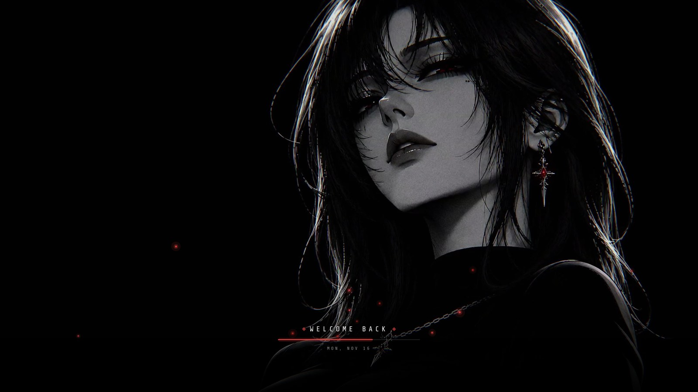
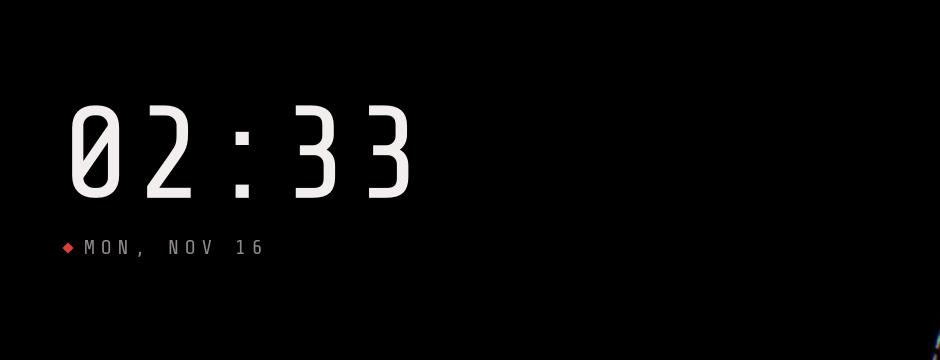
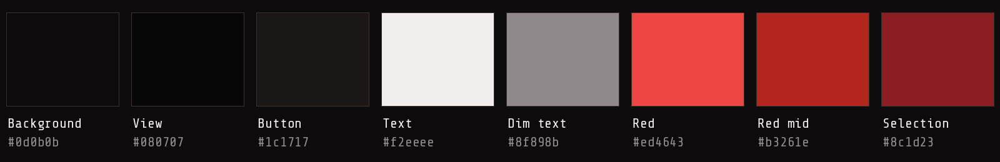

# crimson-dusk-kde

A black, white and red theme for KDE Plasma 6. It matches the [crimson-dusk SDDM theme](https://github.com/davidlovcov/crimson-dusk-sddm), so login, splash and desktop all look the same.





## What's included

- **Global theme** "Crimson Dusk" with a matching **splash screen** (portrait, red embers, red progress line)
- **Colour scheme** `CrimsonDusk` for windows, title bars, panels and selections
- **Font** Share Tech Mono across the interface
- **Desktop clock widget** "Crimson Dusk Clock" with a pulsing red glow
- **Panel Colorizer preset** "Crimson Dusk": near-black panel, faint top line, white icons with a soft red glow
- **kitty** terminal colours (applied only if you use kitty)

## Install

```bash
git clone https://github.com/davidlovcov/crimson-dusk-kde
cd crimson-dusk-kde
./apply.sh
```

Log out and back in once afterwards.

- **Clock:** the script offers to add it. Later: right-click the desktop → Add Widgets → "Crimson Dusk Clock".
- **Panel:** needs the [Panel Colorizer](https://github.com/luisbocanegra/plasma-panel-colorizer) widget on your panel. Open its settings → Presets → "Crimson Dusk".
- **Wallpaper:** use the same video with [Smart Video Wallpaper Reborn](https://github.com/luisbocanegra/plasma-smart-video-wallpaper-reborn), or the still image in `global-theme/.../splash/images/bg.jpg`.

## Undo

```bash
cp ~/.config/kdeglobals.bak-crimson ~/.config/kdeglobals
```

Then pick another Global Theme in System Settings → Colors & Themes.

## Requirements

KDE Plasma 6. The script uses `kwriteconfig6`, `kpackagetool6`, `plasma-apply-lookandfeel` and `plasma-apply-colorscheme`, which come with Plasma.

## Credits & license

GPL-3.0. Share Tech Mono is under the SIL Open Font License (`fonts/`). Background artwork belongs to its original artist ([source](https://moewalls.com/anime/dark-goth-girl-live-wallpaper/)).
